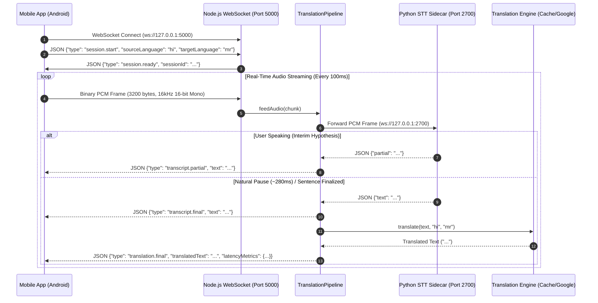

# Live Translator — Streaming Backend Server

High-performance, full-duplex WebSocket backend server for real-time speech translation. Engineered for ultra-low latency (<200ms target), continuous voice streaming, and multi-language translation across Indian and international languages.

---

## 🌟 Key Features

- **Full-Duplex Audio Streaming**: Accepts raw 16kHz 16-bit Mono PCM binary audio frames via WebSocket with zero transcoding overhead.
- **Hybrid Speech-to-Text (STT) Engine**:
  - **Offline Vosk Kaldi Decoder**: Ultra-fast offline local recognition for English (`en-us`) and Hindi (`hi`).
  - **Online High-Accuracy STT**: Cloud recognition with sensitive energy-based Voice Activity Detection (VAD) for Marathi (`mr`), Gujarati (`gu`), Bengali (`bn`), Tamil (`ta`), and Telugu (`te`).
- **Low-Latency Conversational VAD**:
  - ~280ms silence trigger for snappy sentence boundary finalization.
  - 1.8s continuous speech chunking for fast speakers.
  - Preserves initial consonants with a 100ms pre-speech audio buffer.
- **Machine Translation with LRU Memory Cache**:
  - Translates bidirectional pairs across English, Hindi, Marathi, Gujarati, Bengali, Tamil, Telugu, Spanish, French, German.
  - In-memory LRU cache serves repeated conversational phrases in **<1ms**.
- **Stage-by-Stage Latency Telemetry**:
  - Automatically measures and sends `sttLatencyMs`, `translationLatencyMs`, and `totalServerLatencyMs` on every translated segment.
- **Session & Resource Management**:
  - Bounded FIFO queues (`drop_oldest`) prevent memory exhaustion.
  - 15-second heartbeat ping/pong keep-alive prevents NAT/OS dropouts.
  - Automatic reaping of idle or disconnected client sessions.

---

## 🏗️ Server Architecture & Flow



---

## 📦 Directory & Module Breakdown

```text
Server/
├── package.json                   # Node.js dependencies & scripts
├── .env                           # Active environment configuration
├── .env.example                   # Environment configuration template
├── src/
│   ├── app.js                     # Express application & HTTP middleware
│   ├── server.js                  # Entry point: HTTP server, WebSocket setup, sidecar startup
│   ├── config/
│   │   └── env.js                 # Centralized typed environment schema & validation
│   ├── routes/
│   │   └── health.routes.js       # Health check endpoint (GET /health)
│   ├── websocket/
│   │   ├── connection.js          # Client WebSocket connection lifecycle, auth & ping/pong
│   │   └── protocol.js            # Canonical protocol message builders & validation
│   ├── sessions/
│   │   └── sessionManager.js      # Session registry, concurrency limiter & idle reaper
│   ├── queues/
│   │   └── boundedQueue.js        # Bounded FIFO queue with backpressure protection
│   ├── services/
│   │   ├── speechRecognition.js   # Vosk STT WebSocket client & fallback manager
│   │   ├── vosk_server.py         # Python 3.12 STT Sidecar (Vosk Kaldi + Google STT VAD)
│   │   ├── voskSidecarManager.js  # Child process manager to auto-spawn vosk_server.py
│   │   ├── translation.js         # Translation providers (Google Translate + LRU Cache)
│   │   └── metrics.js             # Latency collector (audioReceived -> STT -> MT -> total)
│   ├── pipeline/
│   │   └── translationPipeline.js # Core orchestrator linking STT, MT, and WebSocket responses
│   └── utils/
│       ├── logger.js              # Structured Winston-based JSON logging
│       └── validation.js          # Payload validation & language code verification
└── tests/
    ├── health.test.js             # Unit test for health check route
    ├── pipeline.test.js           # Unit test for translation pipeline stages
    └── websocket.test.js          # Unit test for WebSocket protocol handshakes
```

---

## 🛠️ Technology Stack & Dependencies

| Module / Component | Technology / Library | Version | Purpose |
| :--- | :--- | :--- | :--- |
| **HTTP Framework** | `express` | `^4.19.2` | REST endpoints (`/health`) and basic routing |
| **WebSocket Engine** | `ws` | `^8.18.0` | High-throughput binary and text WebSocket communication |
| **Offline STT** | `vosk` (Python) | `^0.3.45` | Real-time offline Kaldi neural acoustic models (`en`, `hi`) |
| **Online STT** | `SpeechRecognition` (Python) | `^3.17.0` | High-accuracy Indic recognition (`mr-IN`, `gu-IN`, `bn-IN`, `ta-IN`, `te-IN`) |
| **Translation Engine** | Built-in `fetch` + Google GTX | Node Native | Fast neural machine translation with 100+ language support |
| **Logging** | `winston` | `^3.14.2` | Structured multi-level logging with timestamp formatting |
| **Unit Testing** | `jest`, `supertest` | `^29.7.0` | Test runner and HTTP endpoint assertion framework |
| **Sidecar Runtime** | Python 3.12+ | External | Runs `vosk_server.py` on local port `2700` |

---

## ⚙️ Environment Configuration (`.env`)

```ini
# Server Networking
PORT=5000
HOST=0.0.0.0
WS_MAX_PAYLOAD_BYTES=1048576

# Concurrency & Session Limits
SESSION_IDLE_TIMEOUT_MS=60000
MAX_SESSIONS_PER_CLIENT=2
MAX_CONCURRENT_SESSIONS=20
MAX_AUDIO_QUEUE_CHUNKS=100
MAX_TRANSLATION_QUEUE_ITEMS=50

# Speech Recognition Sidecar
STT_PROVIDER=vosk
VOSK_PORT=2700
VOSK_HOST=127.0.0.1
VOSK_SIDECAR_PORT=2700

# Machine Translation
TRANSLATION_PROVIDER=google
LOG_LEVEL=info
```

---

## 🚀 Getting Started

### 1. Prerequisites
- **Node.js**: v20.x or v22.x+
- **Python**: 3.12+ with pip
- **Python Libraries**:
  ```bash
  pip install vosk websockets SpeechRecognition
  ```

### 2. Install Dependencies
```bash
cd Server
npm install
```

### 3. Start the Server
Start the development server with live reload:
```bash
npm run dev
```

The server automatically starts:
1. **HTTP / WebSocket Server** on `http://0.0.0.0:5000` (WebSocket endpoint: `ws://0.0.0.0:5000`).
2. **Vosk STT Sidecar** on `ws://127.0.0.1:2700`.

### 4. Run Unit Tests
```bash
npm test
```

---

## 📡 WebSocket Communication Protocol

### Client → Server Messages

#### 1. Start Session
```json
{
  "type": "session.start",
  "protocolVersion": "1.0",
  "sourceLanguage": "hi",
  "targetLanguage": "mr",
  "audioFormat": {
    "encoding": "pcm_s16le",
    "sampleRate": 16000,
    "channels": 1
  }
}
```

#### 2. Streaming Audio Frames
- **Format**: Raw Binary PCM (16-bit little-endian, 16000Hz, Mono).
- **Chunk Size**: 3200 bytes per frame (~100ms).

#### 3. Heartbeat Ping
```json
{ "type": "ping" }
```

#### 4. Stop Session
```json
{ "type": "session.stop" }
```

---

### Server → Client Messages

#### 1. Session Ready
```json
{
  "type": "session.ready",
  "sessionId": "4b684da7-763d-49d7-8d25-9610f63b01a6"
}
```

#### 2. Partial Transcript (Live Interim Hypothesis)
```json
{
  "type": "transcript.partial",
  "sequence": 1,
  "text": "हाय सब"
}
```

#### 3. Finalized Translation & Latency Metrics
```json
{
  "type": "translation.final",
  "sequence": 1,
  "sourceText": "हाय सब कैसे हो",
  "translatedText": "नमस्कार सर्वजण कसे आहात",
  "sourceLanguage": "hi",
  "targetLanguage": "mr",
  "latencyMetrics": {
    "sttLatencyMs": 15,
    "translationLatencyMs": 85,
    "totalServerLatencyMs": 100
  }
}
```

#### 4. Heartbeat Pong
```json
{ "type": "pong" }
```

---

## 📱 Mobile Device Connection (ADB Reverse)

When testing with a physical Android device connected via USB/Wi-Fi:
```bash
# Reverse backend WebSocket port
adb reverse tcp:5000 tcp:5000

# Reverse Metro bundler port
adb reverse tcp:8081 tcp:8081
```
The mobile application will connect directly via `ws://localhost:5000`.
